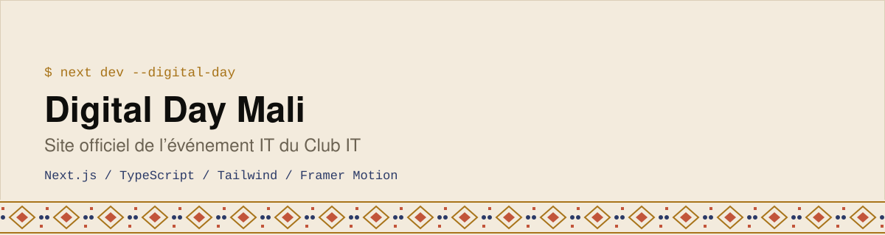

<div align="center">
  <picture>
    <source media="(prefers-color-scheme: dark)" srcset="assets/banner-dark.svg">
    
  </picture>
</div>

Site web de **Digital Day**, l’événement IT organisé par le Club IT au Mali : programme, inscription, informations pratiques et un quiz en direct pendant l’événement.

   

## Ce que contient le site
- **Accueil** avec compte à rebours, présentation du lieu et FAQ
- **Programme**, **Inscription**, **Club**, **Sections** et **Contact**
- **Quiz** : page reliée au projet [Live Quiz](https://github.com/BinaryMaoGenius/live-quiz)
- Animations (particules, transitions) avec Framer Motion

## Lancer le projet
```bash
npm install
npm run dev
```
Le dépôt contient une configuration `render.yaml` pour un déploiement sur Render.

## Projets liés
[Digital Day CTF](https://github.com/BinaryMaoGenius/digital-day-ctf) · [Live Quiz](https://github.com/BinaryMaoGenius/live-quiz)

## Licence

Code sous [licence MIT](./LICENSE) · © 2026 Emmanuel Elisé Koné.
Le nom, les logos et l’identité visuelle de **Digital Day** ne sont pas couverts par cette licence.

---

Construit par **Emmanuel Elisé Koné** ([BinaryMaoGenius](https://github.com/BinaryMaoGenius)) · *La tech en clair*
